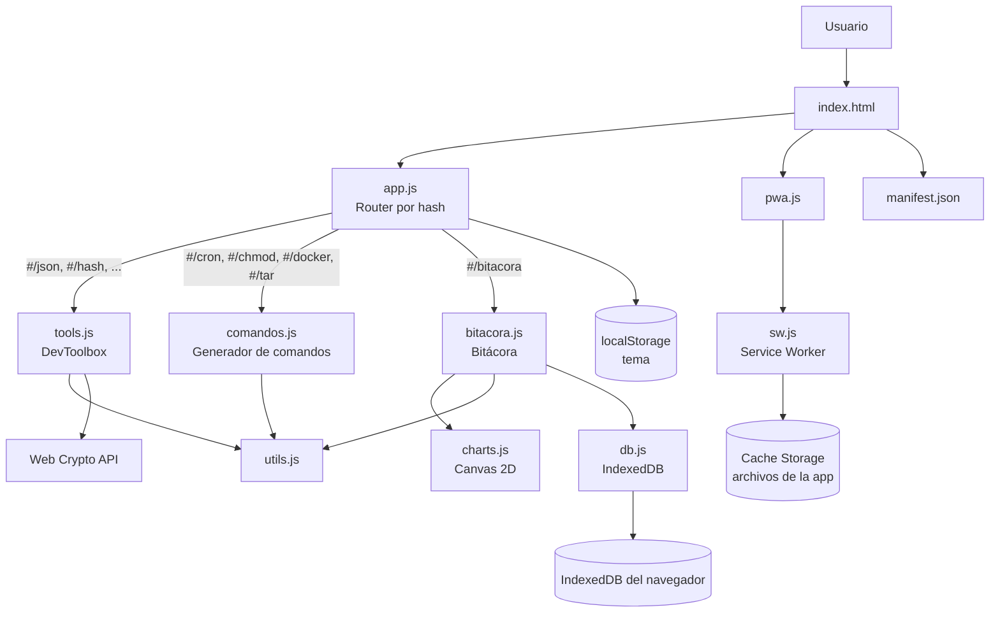
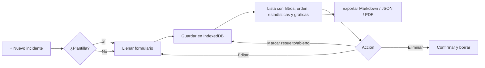

# TechKit — DevToolbox + Bitácora técnica

**Tipo de proyecto:** aplicación web de una sola página (SPA)
**Autor:** Pedro Israel García García · Ingeniería en Informática · ITESI
**Tecnologías:** HTML5, CSS3 y JavaScript puro (Vanilla JS), sin frameworks ni librerías externas
**Estado:** Versión final 3.0 — terminada (3 de 3 sesiones)
**Tipo:** Progressive Web App (PWA): se instala y funciona sin internet
**Fechas:** Sesión 1: 9 nov 2026 · Sesión 2: 16 nov 2026 · Sesión 3: 16 nov 2026

---

## 1. Descripción del problema

Cualquier persona que trabaja en informática, sea estudiante, técnico de soporte, desarrollador o administrador de servidores, repite a diario tareas pequeñas: formatear un JSON, decodificar un token, sacar un hash, convertir un timestamp o probar una expresión regular. Para eso suele usar páginas web de terceros, lo que implica **pegar datos posiblemente sensibles en sitios desconocidos**.

Además, cuando resuelve un problema técnico casi nunca lo documenta, y semanas después vuelve a investigar la misma falla desde cero.

## 2. Solución propuesta

**TechKit** junta tres módulos en una sola aplicación que corre en el navegador y **no envía ningún dato a internet**:

| Módulo | Qué resuelve |
|---|---|
| **DevToolbox** | 8 herramientas de uso diario para desarrolladores y técnicos. Todo se procesa de manera local. |
| **Generador de comandos** | Arma comandos de Linux/Docker desde un formulario (cron, chmod, docker run, tar) y explica cada parte. |
| **Bitácora técnica** | Registro de incidentes (problema, causa y solución) por cliente o equipo, con capturas de pantalla, plantillas, búsqueda, filtros, orden, gráficas y exportación. |

Además, es una **PWA**: se instala como app en la PC o el celular y **funciona completa sin internet**.

### Usuarios objetivo
- Estudiantes de informática y sistemas
- Técnicos de soporte y mesa de ayuda
- Desarrolladores y administradores de servidores o redes
- Freelancers que necesitan reportar lo que hicieron para cada cliente

---

## 3. Estado del proyecto

| Componente | Estado |
|---|---|
| Estructura base, navegación y router | ✅ Terminado |
| Tema claro/oscuro con preferencia guardada | ✅ Terminado |
| Diseño responsivo (escritorio y celular) | ✅ Terminado |
| Herramienta JSON (formatear, minificar, validar) | ✅ Terminado |
| Herramienta Base64 / URL | ✅ Terminado |
| Herramienta Decodificar JWT | ✅ Terminado |
| Herramienta Hash SHA | ✅ Terminado |
| Herramienta UUID (v4 y v7, con inspector) | ✅ Terminado |
| Herramienta Contraseñas (varias a la vez, CSV) | ✅ Terminado |
| Herramienta Timestamp | ✅ Terminado |
| Herramienta Regex | ✅ Terminado |
| Bitácora: CRUD con IndexedDB | ✅ Terminado |
| Bitácora: búsqueda, filtros y estadísticas | ✅ Terminado |
| Bitácora: exportar Markdown, respaldo/importación JSON, imprimir PDF | ✅ Terminado |
| **Sesión 2:** Generador cron (explicación en español y próximas ejecuciones) | ✅ Terminado |
| **Sesión 2:** Calculadora chmod (octal ↔ simbólico, bits especiales) | ✅ Terminado |
| **Sesión 2:** Generador docker run (presets y validación) | ✅ Terminado |
| **Sesión 2:** Generador tar (crear, extraer, listar) | ✅ Terminado |
| **Sesión 2:** Bitácora: plantillas de incidentes | ✅ Terminado |
| **Sesión 2:** Bitácora: gráficas con Canvas (barras y dona) | ✅ Terminado |
| **Sesión 2:** Bitácora: ordenar la lista | ✅ Terminado |
| **Sesión 3:** PWA: manifest, íconos y Service Worker (cache-first) | ✅ Terminado |
| **Sesión 3:** Botón "Instalar app", indicador sin conexión y aviso de actualización | ✅ Terminado |
| **Sesión 3:** Capturas de pantalla en incidentes (subir, arrastrar o pegar) | ✅ Terminado |
| **Sesión 3:** Visor de capturas y respaldo JSON con imágenes | ✅ Terminado |
| **Sesión 3:** Auditoría Lighthouse y correcciones de accesibilidad y rendimiento | ✅ Terminado |
| **Sesión 3:** Guía de publicación con HTTPS | ✅ Terminado |

---

## 4. Estructura del proyecto

```
techkit/
├── index.html          → Estructura de la página: sidebar, contenedor principal y toast
├── manifest.json       → Datos de la PWA: nombre, colores, íconos y accesos directos
├── sw.js               → Service Worker: caché y funcionamiento sin internet
├── README.md           → Esta documentación
├── PLAN-SESIONES.md    → Plan de las 3 sesiones
├── REPORTE-SESION-2.md → Reporte de la sesión 2
├── REPORTE-SESION-3.md → Reporte de la sesión 3 (entrega final)
├── img/                → Íconos de la app (192, 512, maskable, apple-touch, favicon)
├── css/
│   └── styles.css      → Estilos, variables de tema, responsivo e impresión
└── js/
    ├── utils.js        → Funciones compartidas (escape, copiar, descargar, Base64 UTF-8)
    ├── tools.js        → Módulo DevToolbox (8 herramientas)
    ├── comandos.js     → Módulo Generador de comandos (cron, chmod, docker, tar)
    ├── charts.js       → Gráficas dibujadas con Canvas 2D
    ├── db.js           → Capa de datos sobre IndexedDB
    ├── bitacora.js     → Módulo Bitácora (CRUD, plantillas, filtros, orden, gráficas, exportación)
    ├── app.js          → Router por hash y arranque de la app
    └── pwa.js          → Registro del Service Worker, instalación y modo sin conexión
```

El **orden de carga** de los scripts en `index.html` importa, ya que cada archivo depende de los anteriores:

```
utils.js → tools.js → comandos.js → charts.js → db.js → bitacora.js → app.js → pwa.js
```

Todos se cargan con `defer`, así no bloquean el primer dibujado de la página y se ejecutan en ese orden.

```
```

---

## 5. Arquitectura



### Patrón de módulo-vista

Cada pantalla de la app es un **objeto con la misma forma**, lo que permite que el router las trate igual:

```js
{
  title: 'Nombre de la vista',
  desc:  'Descripción corta',
  html:  () => `...marcado HTML...`,   // qué se pinta
  mount: (root) => { ... }             // qué eventos se conectan
}
```

Agregar una herramienta nueva solo requiere crear otro objeto en `Tools` (o en `Comandos`) y un enlace en el menú. El router la detecta solo:

```js
const ROUTES = { ...Tools, ...Comandos, bitacora: Bitacora };
```

El módulo de comandos de la sesión 2 se agregó así, sin modificar ninguna herramienta existente.

---

## 6. Bloques usados

### 6.1 Bloques de HTML (`index.html`)

| Bloque | Elemento | Función |
|---|---|---|
| Barra lateral | `<aside class="sidebar">` | Logo, menú de navegación y botón de tema |
| Navegación | `<nav>` con `<a href="#/ruta" data-route>` | Cada enlace cambia el hash y el router reacciona |
| Contenedor principal | `<main id="app">` | Aquí el router pinta la vista activa |
| Notificación | `<div id="toast" aria-live="polite">` | Mensajes breves como “Copiado” o “Guardado”. Se anuncia a lectores de pantalla |
| Formulario modal | `<dialog>` en la Bitácora | Crear y editar incidentes con el diálogo nativo del navegador |
| Metadatos PWA (sesión 3) | `<link rel="manifest">`, `theme-color`, íconos | Permiten instalar la app y le dan color a la barra del sistema |
| Botón instalar (sesión 3) | `<button id="installBtn" hidden>` | Aparece solo cuando el navegador permite instalar |
| Etiqueta sin conexión (sesión 3) | `<span id="offlineBadge">` | Avisa que no hay internet |
| Aviso de actualización (sesión 3) | `<div id="updateBanner" role="alert">` | Ofrece cargar la versión nueva |
| Zona de capturas (sesión 3) | `<input type="file" accept="image/*" multiple>` + zona de arrastre | Agregar imágenes al incidente |
| Visor (sesión 3) | `<dialog id="bitViewer">` | Ver una captura en grande y descargarla |

### 6.2 Bloques de CSS (`styles.css`)

| Bloque | Qué hace |
|---|---|
| Variables en `:root` | Colores, tipografías y radios centralizados |
| `[data-theme="light"]` | Sobrescribe las variables para el tema claro |
| Layout con CSS Grid | `body` en dos columnas: sidebar + contenido |
| Componentes (`.card`, `.btn`, `.output`, `.entry`, `.badge`) | Piezas reutilizables en todas las vistas |
| `@media (max-width: 800px)` | Responsivo: el menú pasa arriba y las rejillas a una columna |
| `@media print` | Oculta controles al imprimir para exportar la bitácora a PDF |
| `.cron-grid`, `.perm-table`, `.kv.parts` (sesión 2) | Rejilla de campos de cron, tabla de permisos de chmod y listas de "qué hace cada parte" |
| `.charts`, `.chart-tip` (sesión 2) | Distribución de las gráficas y tooltip flotante |
| `.invalid` (sesión 2) | Borde rojo en el campo que tiene un error |
| `.drop`, `.thumbs`, `.thumb`, `.viewer` (sesión 3) | Zona de arrastre, miniaturas y visor de capturas |
| `.offline-badge`, `.update-banner` (sesión 3) | Etiqueta sin conexión y aviso de versión nueva |

### 6.3 Bloques de JavaScript

#### a) Router por hash (`app.js`)
Lee `location.hash`, busca la vista en `ROUTES` y la monta. Reemplaza el contenedor con un clon vacío para **eliminar los listeners de la vista anterior** y evitar fugas de memoria.

```js
const ROUTES = { ...Tools, bitacora: Bitacora };

function router() {
  const name = location.hash.replace('#/', '') || DEFAULT_ROUTE;
  const view = ROUTES[name] || ROUTES[DEFAULT_ROUTE];
  const fresh = app.cloneNode(false);  // contenedor limpio
  app.replaceWith(fresh);
  fresh.innerHTML = view.html();
  view.mount(fresh);
}
window.addEventListener('hashchange', router);
```

#### b) Delegación de eventos (`tools.js`, `bitacora.js`)
En lugar de un listener por botón, se pone **uno solo en el contenedor** y se identifica la acción con el atributo `data-act`:

```js
root.addEventListener('click', (e) => {
  const act = e.target.dataset.act;
  if (act === 'format') run(false);
  if (act === 'minify') run(true);
});
```

Esto funciona también para elementos creados dinámicamente, como las tarjetas de la bitácora.

#### c) Escape de HTML contra XSS (`utils.js`)
Todo texto escrito por el usuario pasa por `escape()` antes de insertarse con `innerHTML`, para que un `<script>` escrito en un incidente se muestre como texto y no se ejecute.

```js
escape(str) {
  return String(str).replace(/&/g,'&amp;').replace(/</g,'&lt;')
    .replace(/>/g,'&gt;').replace(/"/g,'&quot;').replace(/'/g,'&#39;');
}
```

#### d) Base64 con soporte UTF-8 (`utils.js`)
`btoa()` falla con acentos o la ñ. Se convierte primero el texto a bytes con `TextEncoder`:

```js
b64encode(str) {
  const bytes = new TextEncoder().encode(str);
  let bin = '';
  bytes.forEach(b => { bin += String.fromCharCode(b); });
  return btoa(bin);
}
```

#### e) Hash con Web Crypto API (`tools.js`)
`crypto.subtle.digest` devuelve un `ArrayBuffer` y se convierte a hexadecimal. Los cuatro algoritmos se calculan en paralelo con `Promise.all`:

```js
const buf = await crypto.subtle.digest('SHA-256', new TextEncoder().encode(text));
const hex = [...new Uint8Array(buf)].map(b => b.toString(16).padStart(2, '0')).join('');
```

#### f) Aleatoriedad criptográfica (`tools.js`)
Las contraseñas usan `crypto.getRandomValues()` en vez de `Math.random()`, que **no es seguro** para generar contraseñas. Además:
- Se usa **muestreo por rechazo** para que todos los caracteres tengan la misma probabilidad. Así se evita el *sesgo de módulo* de hacer `numero % tamaño`.
- Cada contraseña incluye al menos un carácter de cada tipo elegido, y luego se revuelve con el algoritmo **Fisher-Yates**.
- La fortaleza se estima con la entropía: `longitud × log2(caracteres posibles)`.

#### g) UUID v7 implementado a mano (`tools.js`)
El navegador solo trae `crypto.randomUUID()`, que genera **v4**. La **v7** (RFC 9562) se arma byte por byte:

```
| 48 bits: timestamp en ms | 4 bits: versión 7 | 12 bits: contador | 2 bits: variante | 62 bits: aleatorios |
```

```js
for (let i = 0; i < 6; i++) b[i] = Math.floor(ms / 2 ** (8 * (5 - i))) % 256; // fecha
b[6] = 0x70 | (seq >> 8);          // versión 7
b[7] = seq & 0xff;                 // contador
b[8] = (b[8] & 0x3f) | 0x80;       // variante
```

El **contador de 12 bits** garantiza que, si se generan varios UUID en el mismo milisegundo, salgan en orden. Por eso 1000 UUID generados de golpe quedan ordenados.

**¿Por qué v7 para bases de datos?** Un v4 es aleatorio y, usado como llave primaria, se inserta en cualquier parte del índice B-tree, lo que fragmenta la tabla. El v7 crece con el tiempo, así que se inserta al final, igual que un autoincremental, pero sigue siendo único entre servidores. El inspector de la pestaña extrae la fecha de creación de un v7.

#### h) Resaltado de regex (`tools.js`)
Con `matchAll` se obtienen todas las coincidencias con su índice, y se arma el HTML intercalando texto escapado con etiquetas `<mark>`.

#### i) Capa de datos IndexedDB con Promesas (`db.js`)
IndexedDB funciona con eventos (`onsuccess`, `onerror`). Se envuelve en Promesas para usar `async/await`:

```js
async _tx(mode, fn) {
  const db = await this.open();
  return new Promise((resolve, reject) => {
    const tx = db.transaction(this.STORE, mode);
    const req = fn(tx.objectStore(this.STORE));
    tx.oncomplete = () => resolve(req?.result);
    tx.onerror = () => reject(tx.error);
  });
}

getAll()   { return this._tx('readonly',  s => s.getAll()); }
add(item)  { return this._tx('readwrite', s => s.add(item)); }
put(item)  { return this._tx('readwrite', s => s.put(item)); }
remove(id) { return this._tx('readwrite', s => s.delete(id)); }
```

#### j) Formulario con `<dialog>` + `FormData` (`bitacora.js`)
El formulario usa `method="dialog"`: al presionar un botón, el diálogo se cierra y guarda el `value` de ese botón en `returnValue`. Si es `save`, se leen los campos con `FormData`:

```js
dialog.addEventListener('close', async () => {
  if (dialog.returnValue !== 'save') return;
  await this.save(new FormData(form));
});
```

#### k) Exportación con Blob (`utils.js`)
Se genera el archivo en memoria y se descarga con un enlace temporal, sin servidor:

```js
const blob = new Blob([content], { type });
const url = URL.createObjectURL(blob);
const a = document.createElement('a');
a.href = url; a.download = filename; a.click();
URL.revokeObjectURL(url);
```

#### l) Tema persistente (`app.js`)
Cambia el atributo `data-theme` del `<html>` y lo guarda en `localStorage`. Va dentro de `try/catch` porque en modo incógnito el almacenamiento puede estar bloqueado.

### 6.4 Bloques nuevos de la Sesión 2

#### m) Parser de cron (`comandos.js`)
Cada campo se convierte en un `Set` con todos los valores que acepta. Una sola expresión regular reconoce `*`, `5`, `1-5`, `*/15` y `1-5/2`, y las listas se separan por coma:

```js
const m = parte.match(/^(\*|(\d+)(?:-(\d+))?)(?:\/(\d+))?$/);
for (let v = ini; v <= fin; v += paso) valores.add(v);
```

Con esos conjuntos, las **próximas ejecuciones** se calculan avanzando minuto a minuto desde ahora y revisando si cada fecha coincide (máximo un año). Se respeta la regla de cron: si se restringen *día del mes* y *día de la semana* a la vez, basta con que se cumpla uno.

La **explicación en español** se arma por partes (hora, días, meses) y se unen con una función `lista()` que produce "a, b y c".

#### n) Operaciones a nivel de bits para chmod (`comandos.js`)
Cada permiso es un bit: lectura = 4, escritura = 2 y ejecución = 1. La suma da el dígito octal, y para regresar del número a los checkboxes se usa el **AND binario** `&`:

```js
checkbox.checked = (digito & valor) !== 0;   // 5 & 4 = 4 → lectura sí; 5 & 2 = 0 → escritura no
```

Los bits especiales (SUID = 4, SGID = 2, Sticky = 1) forman un cuarto dígito al inicio (`4755`, `1777`) y cambian la `x` por `s`/`S` o `t`/`T` en el modo simbólico. La sincronización es en tres sentidos: checkboxes ↔ octal ↔ simbólico. Una entrada inválida se marca en rojo sin borrar lo demás.

#### o) Construcción segura de comandos (`comandos.js`)
Los valores con espacios o caracteres especiales del shell se envuelven en comillas simples, para que el comando copiado funcione tal cual:

```js
const q = (v) => /^[\w@%+=:,./-]+$/.test(v) ? v : `'${v.replace(/'/g, `'\\''`)}'`;
```

Los generadores de docker y tar guardan cada fragmento junto con su explicación (`[fragmento, explicación]`). Con esa misma lista se arma el comando y la tabla "Qué hace cada parte", así nunca quedan desfasados. Además se validan los puertos (máximo 65535), las rutas de los volúmenes y los nombres de las variables, y se detectan combinaciones incompatibles como `--rm` con `--restart`.

#### p) Gráficas con Canvas 2D (`charts.js`)
Se dibujan sin librerías:
- **Nitidez HiDPI:** el canvas se crea con `ancho × devicePixelRatio` y se escala con `setTransform`, para que no se vea borroso en pantallas de alta densidad.
- **Barras horizontales** con el extremo redondeado (`arcTo`) y la etiqueta a la izquierda, para que los nombres de categoría nunca se encimen.
- **Dona** con `arc()` y una pequeña separación entre segmentos, con el total al centro y la leyenda a la derecha.
- **Colores del tema:** se leen de las variables CSS con `getComputedStyle`, y al cambiar de tema se lanza un evento `themechange` para redibujar.
- **Tooltip:** cada barra o segmento guarda una "zona" con su función de detección (para la dona se usa `Math.atan2` y se compara el ángulo). El evento `mousemove` busca la zona bajo el cursor y muestra el detalle.

#### q) Plantillas y ordenamiento (`bitacora.js`)
- Las **plantillas** son objetos con los campos típicos de una falla. Al elegir una se llenan título, categoría, prioridad, problema, causa, solución y etiquetas, pero **no** se tocan el cliente ni la fecha. Los botones llevan `type="button"` para no cerrar el `<dialog>`.
- El **ordenamiento** usa un mapa de funciones comparadoras y trabaja sobre una copia (`[...lista].sort()`), para no alterar los datos originales. El orden "Prioridad" usa pesos (`alta: 0, media: 1, baja: 2`) y desempata por fecha.

### 6.5 Bloques nuevos de la Sesión 3

#### r) Manifest de la PWA (`manifest.json`)
Le dice al navegador cómo instalar la app: nombre, colores, íconos y modo `standalone` (ventana propia, sin barra del navegador). Incluye un ícono **maskable** para Android y **accesos directos** (Bitácora, Contraseñas, Cron) que aparecen al dejar presionado el ícono. Las rutas son relativas (`./`), así funciona igual en `localhost/techkit/` que en un hosting.

#### s) Service Worker con estrategia cache-first (`sw.js`)
Es un script que el navegador ejecuta aparte de la página y que intercepta las peticiones:

```js
// install: guarda la app completa
caches.open(VERSION).then(cache => cache.addAll(ARCHIVOS));

// activate: borra versiones viejas
caches.keys().then(claves => Promise.all(
  claves.filter(c => c !== VERSION).map(c => caches.delete(c))));

// fetch: primero la caché, si no está, la red
caches.match(req).then(enCache => enCache || fetch(req));
```

- Si no hay internet y se pide una página, responde con `index.html` desde la caché.
- Solo atiende peticiones `GET` del mismo origen.
- **Para publicar cambios** se sube el número de `VERSION`. El navegador detecta el `sw.js` nuevo y la app muestra el aviso "Hay una versión nueva", con un botón que activa la nueva versión (`skipWaiting`) y recarga una sola vez.

#### t) Instalación e indicador sin conexión (`pwa.js`)
- `beforeinstallprompt`: el navegador avisa que la app se puede instalar. Se guarda el evento y se muestra el botón **⬇ Instalar app**, que llama a `prompt()`.
- `appinstalled` y `display-mode: standalone`: ocultan el botón cuando ya está instalada.
- `online` / `offline` + `navigator.onLine`: muestran la etiqueta **Sin conexión** (la app sigue funcionando).
- El registro solo se hace en un **contexto seguro** (`https://` o `localhost`).

#### u) Capturas guardadas como Blob en IndexedDB (`bitacora.js`)
IndexedDB puede guardar archivos binarios (`Blob`/`File`) directamente, sin convertirlos a texto:

```js
adjuntos: [{ nombre, tipo, tamano, blob: archivo }]   // se guarda tal cual con DB.put()
```

- Tres formas de agregar: **elegir archivos**, **arrastrar y soltar** (`dragover` / `drop`) y **pegar con Ctrl+V** (`paste` + `clipboardData.files`). Esta última es la más práctica, porque tomas la captura con *Win + Shift + S* y la pegas directo.
- **Validaciones:** solo imágenes, máximo 2 MB cada una y 5 por incidente.
- Para mostrarlas se usa `URL.createObjectURL(blob)`. Cada vez que se redibuja la lista, se liberan las URLs anteriores con `URL.revokeObjectURL`, para no acumular memoria.
- Visor en un `<dialog>` con la imagen en grande y botón para descargarla.

#### v) Respaldo JSON con imágenes (`bitacora.js`)
JSON solo guarda texto, así que al exportar cada imagen se convierte a **data URL Base64** con `FileReader.readAsDataURL`. Al importar, se decodifica con `atob` y se reconstruye el `Blob`:

```js
const bytes = Uint8Array.from(atob(base64), c => c.charCodeAt(0));
return new Blob([bytes], { type: tipo });
```

Solo se aceptan data URLs que empiecen con `data:image/`.

#### w) Optimización según Lighthouse
- Scripts con `defer`: ya no bloquean el renderizado.
- `aria-label` en los selects y campos que no tenían etiqueta visible, y `<label for>` en todo el formulario de incidentes.
- La Bitácora se muestra hasta que termina de leer IndexedDB, para que la página no "brinque" (CLS).
- En celular, el layout usa `grid-template-rows: auto 1fr`, para que el menú no cambie de tamaño al cargar.

---

## 7. Funcionamiento de cada herramienta

### DevToolbox

| Herramienta | Entrada | Salida | Detalles |
|---|---|---|---|
| **JSON** | Texto JSON | JSON formateado o minificado | Indentación de 2, 4 o tab. Si es inválido muestra el mensaje de error del parser |
| **Base64 / URL** | Texto | Texto codificado o decodificado | Soporta acentos y emojis. URL usa `encodeURIComponent` |
| **Decodificar JWT** | Token `xxx.yyy.zzz` | Header y payload en JSON | Indica si está vigente o expirado según `exp`. **No verifica la firma** porque eso requiere la clave secreta |
| **Hash SHA** | Texto | SHA-1, SHA-256, SHA-384, SHA-512 | Botón para copiar cada hash |
| **UUID** | Versión (v7/v4) y cantidad (1 a 1000) | Lista de UUID | Opciones de mayúsculas y sin guiones; copiar o descargar .txt. El inspector muestra la versión y la fecha de un v7 |
| **Contraseñas** | Cantidad (1 a 500), longitud y tipos de carácter | Una contraseña por usuario | Garantiza un carácter de cada tipo, permite excluir parecidos (0 O l 1 I), indica la fortaleza y descarga CSV `usuario,contrasena` |
| **Timestamp** | Unix o fecha | Fecha local, UTC, ISO 8601 o timestamp | Detecta segundos o milisegundos según la cantidad de dígitos. Reloj en vivo |
| **Regex** | Patrón, flags y texto | Coincidencias resaltadas y grupos | Se actualiza mientras escribes |

### Generador de comandos

| Herramienta | Entrada | Salida | Detalles |
|---|---|---|---|
| **Cron** | 5 campos, una plantilla o una expresión pegada | Expresión, explicación en español, línea de crontab y próximas 5 ejecuciones | Acepta `*`, rangos, pasos, listas, nombres (`mon-fri`, `jan`) y macros (`@daily`, `@reboot`). Marca en rojo el campo con error |
| **chmod** | Checkboxes, número octal o texto simbólico | `chmod 755 archivo`, vista `ls -l` y significado | Bits especiales SUID/SGID/Sticky, presets comunes, opción `-R` y aviso al dar escritura a "otros" |
| **docker run** | Imagen, tag, nombre, puertos, volúmenes, variables, red y opciones | Comando en una línea o multilínea | Presets (nginx, mysql, postgres, redis, ubuntu), validación y explicación de cada opción |
| **tar** | Operación, compresión, archivo, origen, exclusiones, destino | `tar -czvf …` | La extensión cambia sola con la compresión (`.tar.gz`, `.tar.bz2`, `.tar.xz`), opción de fecha automática con `$(date +%F)` y explicación de cada letra |

**Ejemplos de explicación de cron**

| Expresión | Explicación generada |
|---|---|
| `0 8 * * 1-5` | A las 8:00, de lunes a viernes |
| `*/15 * * * *` | Cada 15 minutos |
| `30 2 * * 0` | A las 2:30, los domingos |
| `0 9,13,18 * * *` | A las 9:00, 13:00 y 18:00, todos los días |
| `0 0 1,15 * *` | A las 0:00, los días 1 y 15 del mes |
| `0 9-17 * * mon-fri` | En el minuto 0, de las 9 h a las 17 h, de lunes a viernes |

### Bitácora técnica

**Flujo de uso**



**Modelo de datos (registro en el almacén `incidentes`)**

| Campo | Tipo | Obligatorio | Descripción |
|---|---|---|---|
| `id` | número | auto | Llave primaria autoincremental |
| `titulo` | texto | sí | Resumen del incidente |
| `cliente` | texto | sí | Cliente, área o equipo afectado |
| `fecha` | texto (`yyyy-MM-ddTHH:mm`) | sí | Cuándo ocurrió |
| `categoria` | texto | sí | Hardware, Software, Redes, Servidores, Seguridad, Base de datos, Otro |
| `prioridad` | `alta` / `media` / `baja` | sí | Define el color del borde de la tarjeta |
| `estado` | `abierto` / `resuelto` | sí | Se alterna con un botón |
| `problema` | texto | sí | Descripción de la falla |
| `causa` | texto | no | Causa raíz encontrada |
| `solucion` | texto | no | Cómo se resolvió |
| `etiquetas` | arreglo de texto | no | Se escriben separadas por coma y se guardan en minúsculas |
| `adjuntos` | arreglo de `{nombre, tipo, tamano, blob}` | no | Capturas de pantalla (máx. 5 de 2 MB). El `blob` es la imagen binaria |
| `actualizado` | ISO 8601 | auto | Última modificación |

Índices creados: `fecha` y `estado`.

**Funciones**
- **Estadísticas:** total, abiertos, resueltos y abiertos de prioridad alta.
- **Búsqueda:** en título, cliente, problema, causa, solución y etiquetas.
- **Filtros:** por estado, prioridad y categoría. Se combinan con la búsqueda.
- **Plantillas (sesión 2):** Sin red, Impresora, Usuario bloqueado, Equipo lento y Disco lleno. Precargan el formulario con los pasos típicos de diagnóstico y solución.
- **Ordenar (sesión 2):** más recientes, más antiguos, prioridad (alta primero), abiertos primero o título A-Z. La exportación a Markdown respeta el orden elegido.
- **Gráficas (sesión 2):** barras de incidentes por categoría y dona de abiertos vs resueltos. Reflejan los filtros activos, tienen tooltip al pasar el mouse y se adaptan al tema y al tamaño de la ventana.
- **Exportar Markdown:** genera un `.md` con los incidentes **filtrados**, útil para reportes.
- **Respaldo JSON:** descarga todos los registros para pasarlos a otra computadora.
- **Importar JSON:** agrega los registros de un respaldo. Ignora los `id` para no sobrescribir datos existentes y descarta registros sin título o problema.
- **Imprimir / PDF:** usa `window.print()` con la hoja de estilos de impresión. Las capturas salen como miniaturas.
- **Capturas (sesión 3):** se agregan eligiendo archivos, arrastrando o pegando con Ctrl+V. Al hacer clic en una miniatura se abre en grande y se puede descargar. El respaldo JSON las incluye y el Markdown lista sus nombres.

### PWA (sesión 3)

| Función | Cómo se usa |
|---|---|
| **Instalar** | Botón **⬇ Instalar app** en el menú (o el ícono de instalar en la barra de direcciones de Chrome/Edge). En Android: menú ⋮ → *Instalar app* |
| **Sin internet** | Después de abrirla una vez, todo funciona sin conexión. Aparece la etiqueta *Sin conexión* |
| **Actualizaciones** | Cuando se publica una versión nueva aparece un aviso con el botón **Actualizar** |
| **Accesos directos** | Clic derecho (PC) o presión larga (celular) sobre el ícono: Bitácora, Contraseñas, Cron |

---

## 8. APIs del navegador utilizadas

| API | Uso |
|---|---|
| DOM API | Crear y actualizar la interfaz |
| `hashchange` | Navegación entre vistas sin recargar |
| IndexedDB | Base de datos de la bitácora |
| localStorage | Guardar el tema elegido |
| Web Crypto (`subtle.digest`, `getRandomValues`, `randomUUID`) | Hashes, contraseñas y UUID |
| `TextEncoder` / `TextDecoder` | Conversión de texto a bytes para Base64 y hashes |
| Clipboard API | Botones de copiar |
| Blob + `URL.createObjectURL` | Descarga de archivos generados |
| `File.text()` | Leer el JSON a importar |
| `<dialog>` + `FormData` | Formulario modal de incidentes |
| `window.print()` | Exportar a PDF |
| Canvas 2D (`arc`, `arcTo`, `fillText`, `measureText`) | Gráficas de la bitácora (sesión 2) |
| `devicePixelRatio` | Gráficas nítidas en pantallas HiDPI (sesión 2) |
| `Event` / `dispatchEvent` | Aviso de cambio de tema a las gráficas (sesión 2) |
| `Intl` (`toLocaleString('es-MX')`) | Fechas de las próximas ejecuciones de cron (sesión 2) |
| Service Worker API (`install`, `activate`, `fetch`, `message`) | Funcionamiento sin internet y actualizaciones (sesión 3) |
| Cache Storage API (`caches`) | Guardar los archivos de la app (sesión 3) |
| Web App Manifest | Instalación como app (sesión 3) |
| `beforeinstallprompt` / `appinstalled` | Botón Instalar app (sesión 3) |
| `navigator.onLine` + eventos `online`/`offline` | Indicador sin conexión (sesión 3) |
| `Blob` en IndexedDB, `URL.createObjectURL` | Guardar y mostrar capturas (sesión 3) |
| Drag and Drop API, evento `paste` (`clipboardData`) | Agregar capturas arrastrando o pegando (sesión 3) |
| `FileReader.readAsDataURL` / `atob` | Respaldo JSON con imágenes (sesión 3) |

---

## 9. Cómo ejecutarlo

No requiere instalación ni dependencias.

**Opción 1, recomendada:** abrir la carpeta en VS Code y usar la extensión **Live Server** sobre `index.html`.

**Opción 2:** desde la carpeta del proyecto, levantar un servidor local:

```bash
python -m http.server 8000
```

y abrir `http://localhost:8000`.

**Opción 3:** abrir `index.html` con doble clic. Funciona en Chrome y Edge. Algunos navegadores restringen IndexedDB o Web Crypto al abrir archivos locales, por eso se recomiendan las opciones 1 o 2.

> Web Crypto y el Service Worker solo funcionan en `https://` o en `localhost`. Con XAMPP (`http://localhost/techkit/`) funciona todo, incluida la instalación. Si se abre con doble clic (`file://`), la app funciona pero **no se puede instalar ni usar sin internet**.

### Publicación con HTTPS

**Opción A: GitHub Pages (gratis, HTTPS automático)**
1. Crear un repositorio en GitHub, por ejemplo `techkit`.
2. Subir el contenido de la carpeta `techkit/` a la raíz del repositorio (con *Add file → Upload files*, o con `git push`).
3. En el repositorio: **Settings → Pages → Source: Deploy from a branch → Branch: `main` / `(root)` → Save**.
4. En uno o dos minutos queda en `https://TU-USUARIO.github.io/techkit/`.

**Opción B: Hostinger u otro hosting**
1. Subir la carpeta a `public_html/techkit/` con el Administrador de archivos o por FTP.
2. Activar el certificado SSL (en Hostinger viene incluido) y forzar HTTPS.
3. Entrar a `https://tu-dominio.com/techkit/`.

**Al publicar una actualización:** cambiar `VERSION` en `sw.js` (por ejemplo `techkit-v3.0.1`). Si no se cambia, los usuarios seguirán viendo la versión guardada en la caché.

**Comprobar que quedó bien:** abrir la página, presionar F12 → **Application** → *Manifest* (sin errores) y *Service workers* (estado *activated*). Después activar la casilla *Offline* y recargar: la app debe seguir funcionando.

---

## 10. Pruebas realizadas

| Prueba | Resultado esperado | Resultado |
|---|---|---|
| Formatear `{"a":1,"b":[1,2]}` | JSON indentado | ✅ |
| Formatear `{"a":` | Mensaje “JSON inválido” | ✅ |
| Base64 de `¿Qué tal?` y regreso | `wr9RdcOpIHRhbD8=` y texto original | ✅ |
| Decodificar JWT con `exp` futuro | Payload visible y “Vigente” | ✅ |
| SHA-1 de `abc` | `a9993e364706816aba3e25717850c26c9cd0d89d` | ✅ |
| SHA-256 de `abc` | Comienza con `ba7816bf8f01cfea…` | ✅ |
| Timestamp `1762732800` | 2025-11-10T00:00:00Z | ✅ |
| Regex de IPv4 sobre texto de ejemplo | 2 coincidencias resaltadas | ✅ |
| Crear 2 incidentes | Aparecen en la lista y las estadísticas se actualizan | ✅ |
| Cambiar estado a resuelto | Contadores de abiertos/resueltos cambian | ✅ |
| Buscar “spooler” | Solo 1 resultado | ✅ |
| Exportar Markdown | Descarga `.md` con los incidentes | ✅ |
| Recargar la página | Los incidentes siguen ahí | ✅ |
| **Sesión 2** | | |
| Cron `0 8 * * 1-5` | "A las 8:00, de lunes a viernes" y 5 fechas entre semana | ✅ |
| Cron `61 * * * *` | Error "fuera de rango (0-59)" y campo en rojo | ✅ |
| Cambiar el campo Hora a 22 | La expresión cambia a `0 22 * * 1-5` | ✅ |
| chmod rwx / r-x / r-x | `755` y `rwxr-xr-x` | ✅ |
| Escribir `750` | Se marcan los checkboxes correctos y queda `rwxr-x---` | ✅ |
| Escribir `rwsr-xr-x` | `4755` (SUID) | ✅ |
| Preset `1777` | `rwxrwxrwt` y aviso de seguridad | ✅ |
| docker: imagen nginx, puerto 8080:80, -d | `docker run -d -p 8080:80 nginx` | ✅ |
| docker: puerto `99999:80` | Error "Puerto inválido" | ✅ |
| tar con compresión xz | `respaldo.tar.xz` y `tar -cJvf …` | ✅ |
| tar extraer con destino | `tar -xJvf respaldo.tar.xz -C /srv/app` | ✅ |
| Plantilla "Sin red" | Formulario con categoría Redes y prioridad alta | ✅ |
| 3 incidentes de Redes | La barra de Redes marca 3 | ✅ |
| 4 abiertos y 2 resueltos | Dona con 67% y 33% | ✅ |
| Ordenar por prioridad | Primero los de prioridad alta | ✅ |
| Cambiar tema con la bitácora abierta | Las gráficas se redibujan con los colores nuevos | ✅ |
| Vista en celular (390 px) | Todo en una columna, sin desbordes | ✅ |
| **Sesión 3** | | |
| Manifest e instalabilidad (Chrome DevTools Protocol) | 0 errores de manifest y 0 errores de instalabilidad | ✅ |
| Service Worker al cargar | Queda activo y guarda los 17 archivos en caché | ✅ |
| Modo avión + recargar | La app abre y navega entre todas las vistas | ✅ |
| Bitácora sin internet | Los incidentes y las capturas se siguen viendo | ✅ |
| Quitar el internet con la app abierta | Aparece la etiqueta "Sin conexión" | ✅ |
| Publicar una versión nueva del `sw.js` | Aparece el aviso; "Actualizar" activa la nueva caché y recarga | ✅ |
| Subir 2 capturas | 2 miniaturas en el formulario y en la tarjeta | ✅ |
| Subir una imagen de 5.6 MB | Aviso "pesa más de 2 MB" y no se agrega | ✅ |
| Quitar una captura antes de guardar | Se elimina del formulario | ✅ |
| Pegar una imagen con Ctrl+V | Se agrega como `captura-<fecha>.png` | ✅ |
| Clic en una miniatura | Se abre el visor con el nombre, el tamaño y el botón Descargar | ✅ |
| Recargar la página | Las capturas siguen guardadas | ✅ |
| Respaldo JSON → borrar la base → importar | El incidente vuelve con sus 3 capturas y se ven bien | ✅ |
| Exportar Markdown | Incluye la línea "Capturas:" con nombres y tamaños | ✅ |
| Regresión de las sesiones 1 y 2 | Todas las pruebas anteriores siguen pasando | ✅ |
| Consola del navegador | Sin errores | ✅ |

### Auditoría Lighthouse (versión final)

| Vista | Rendimiento (móvil / PC) | Accesibilidad | Buenas prácticas | SEO |
|---|---|---|---|---|
| JSON | 99 / 100 | 100 | 100 | 100 |
| UUID | 98 / 100 | 100 | 100 | 100 |
| Contraseñas | 99 / 100 | 100 | 100 | 100 |
| Regex | 99 / 100 | 100 | 100 | 100 |
| Cron | 100 / 100 | 100 | 100 | 100 |
| chmod | 99 / 100 | 100 | 100 | 100 |
| docker run | 100 / 100 | 100 | 100 | 100 |
| tar | 100 / 100 | 100 | 100 | 100 |
| Bitácora | 100 / 100 | 100 | 100 | 100 |

Antes de las correcciones, la Bitácora en móvil tenía **77** de rendimiento y **96** de accesibilidad. Lighthouse 12 ya no tiene categoría "PWA", por eso la instalabilidad se verificó directamente con las herramientas de Chrome.

---

## 11. Mejoras futuras

El proyecto quedó completo. Algunas ideas para seguir mejorándolo:

1. **Sincronización opcional** entre dispositivos (por ejemplo, exportar a un archivo en Google Drive).
2. **Cifrar la bitácora** con una contraseña maestra (Web Crypto, AES-GCM).
3. Más generadores: `ssh`, `rsync`, `iptables`/`ufw`, `netplan`.
4. **Calculadora de subredes IPv4/VLSM** dentro del DevToolbox.
5. Gráfica de incidentes por mes.
