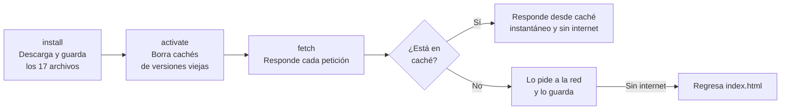

# Reporte de avance — Sesión 3 (entrega final)

| | |
|---|---|
| **Proyecto** | TechKit — DevToolbox + Generador de comandos + Bitácora técnica |
| **Alumno** | Pedro Israel García García |
| **Carrera** | Ingeniería en Informática — ITESI |
| **Tecnologías** | HTML5, CSS3 y JavaScript puro (Vanilla JS), sin frameworks ni librerías |
| **Sesión** | 3 de 3 — entrega final |
| **Fecha** | 16 de noviembre de 2026 |
| **Versión** | 3.0 |

---

## 1. Objetivo de la sesión

Convertir TechKit en una **Progressive Web App (PWA)**, es decir, una página web que **se instala como aplicación** en la PC o el celular y **funciona completa sin internet**. Además, agregar **capturas de pantalla** a los incidentes de la Bitácora, revisar la calidad con **Lighthouse** y dejar el proyecto listo para publicarse y entregarse.

## 2. Resumen de lo realizado

| Actividad | Estado |
|---|---|
| `manifest.json` e íconos de la app | ✅ |
| Service Worker con caché para funcionar sin internet | ✅ |
| Botón "Instalar app", etiqueta "Sin conexión" y aviso de versión nueva | ✅ |
| Capturas de pantalla en los incidentes (elegir, arrastrar o pegar) | ✅ |
| Visor de capturas y descarga | ✅ |
| Respaldo e importación JSON que incluyen las imágenes | ✅ |
| Auditoría Lighthouse y correcciones | ✅ |
| Pruebas completas (sesiones 1, 2 y 3) | ✅ |
| Guía de publicación con HTTPS | ✅ |
| Documentación final (`README.md`, `PLAN-SESIONES.md`) | ✅ |

---

## 3. Archivos de la sesión

| Archivo | Tipo | Descripción |
|---|---|---|
| `manifest.json` | **Nuevo** | Nombre, colores, íconos, modo de pantalla y accesos directos de la app |
| `sw.js` | **Nuevo** | Service Worker: guarda la app en caché y la sirve sin internet |
| `js/pwa.js` | **Nuevo** | Registro del Service Worker, botón Instalar, etiqueta sin conexión y aviso de actualización |
| `img/` (5 íconos) | **Nuevo** | 192 px, 512 px, maskable 512 px, apple-touch-icon y favicon |
| `js/bitacora.js` | Modificado | Capturas de pantalla, visor, respaldo con imágenes y etiquetas accesibles |
| `js/tools.js` | Modificado | Etiquetas accesibles (`aria-label`) |
| `index.html` | Modificado | Metadatos de la PWA, botón Instalar, avisos y scripts con `defer` |
| `css/styles.css` | Modificado | Estilos de capturas, visor, avisos y ajuste del layout en celular |

**Estructura final del proyecto**

```
techkit/
├── index.html
├── manifest.json        ← nuevo
├── sw.js                ← nuevo
├── README.md
├── PLAN-SESIONES.md
├── REPORTE-SESION-2.md
├── REPORTE-SESION-3.md
├── img/                 ← nuevo (íconos)
├── css/
│   └── styles.css
└── js/
    ├── utils.js
    ├── tools.js
    ├── comandos.js
    ├── charts.js
    ├── db.js
    ├── bitacora.js
    ├── app.js
    └── pwa.js           ← nuevo
```

---

## 4. Desarrollo y funcionamiento

### 4.1 ¿Qué es una PWA y por qué TechKit lo necesita?

Una PWA es una página web que cumple tres requisitos para que el navegador permita instalarla:

1. Se sirve por **HTTPS** (o desde `localhost`).
2. Tiene un **manifest**, un archivo que describe la app.
3. Tiene un **Service Worker**, un script que permite funcionar sin internet.

Para TechKit esto es clave, porque la idea del proyecto es que las herramientas **no dependan de internet ni envíen datos a ningún servidor**. Un técnico puede llegar a revisar un equipo sin red y aun así usar la bitácora, el generador de comandos o la calculadora de permisos.

### 4.2 Manifest (`manifest.json`)

Define cómo se ve la app instalada:

```json
{
  "name": "TechKit — Herramientas para informáticos",
  "short_name": "TechKit",
  "start_url": "./#/json",
  "scope": "./",
  "display": "standalone",
  "theme_color": "#0f1115",
  "icons": [
    { "src": "img/icon-192.png", "sizes": "192x192", "purpose": "any" },
    { "src": "img/icon-maskable-512.png", "sizes": "512x512", "purpose": "maskable" }
  ],
  "shortcuts": [ { "name": "Bitácora", "url": "./#/bitacora" } ]
}
```

- `display: standalone` hace que se abra en su propia ventana, sin la barra del navegador.
- El ícono **maskable** tiene margen de seguridad para que Android lo pueda recortar en círculo o en "squircle" sin cortar el logo.
- Los **accesos directos** aparecen al dar clic derecho (PC) o al dejar presionado el ícono (celular).
- Todas las rutas son **relativas** (`./`), así funciona igual en `localhost/techkit/` que en un hosting.

### 4.3 Service Worker (`sw.js`)

Es un script que el navegador ejecuta **en segundo plano**, aparte de la página, y que intercepta todas las peticiones. Su ciclo de vida tiene tres etapas:



**Estrategia cache-first** (primero la caché):

```js
self.addEventListener('fetch', (event) => {
  event.respondWith(
    caches.match(event.request).then(enCache => enCache || fetch(event.request))
  );
});
```

**Actualizaciones.** Cada versión tiene un nombre de caché (`techkit-v3.0.0`). Al publicar cambios se sube ese número. El navegador detecta que el `sw.js` cambió, descarga la nueva versión y la deja "en espera". La app muestra el aviso **"Hay una versión nueva"**, y al presionar **Actualizar** se envía el mensaje `SKIP_WAITING`, la nueva versión toma el control y la página se recarga una sola vez.

### 4.4 Instalación y modo sin conexión (`pwa.js`)

| Evento / API | Qué hace en TechKit |
|---|---|
| `navigator.serviceWorker.register('sw.js')` | Registra el Service Worker (solo en HTTPS o localhost) |
| `beforeinstallprompt` | El navegador avisa que la app es instalable: se guarda el evento y aparece el botón **⬇ Instalar app** |
| `prompt()` / `userChoice` | Al presionar el botón se muestra el cuadro de instalación del sistema |
| `appinstalled` / `display-mode: standalone` | Oculta el botón si la app ya está instalada |
| `online` / `offline` / `navigator.onLine` | Muestra u oculta la etiqueta **Sin conexión** |
| `updatefound` / `controllerchange` | Detecta la versión nueva y recarga al activarla |

### 4.5 Capturas de pantalla en la Bitácora

**Para qué sirve:** al documentar una falla, una imagen del error o de la configuración vale más que una descripción. Ahora cada incidente puede llevar hasta **5 capturas de 2 MB**.

**Tres formas de agregarlas:**
1. **Elegir archivos** con el selector (`<input type="file" accept="image/*" multiple>`).
2. **Arrastrar y soltar** sobre la zona punteada (eventos `dragover` y `drop`).
3. **Pegar con Ctrl+V**: se toma la captura con *Win + Shift + S* y se pega directo en el formulario (evento `paste` y `clipboardData.files`).

**Cómo se guardan.** IndexedDB puede guardar archivos binarios directamente, sin convertirlos a texto, así que la imagen se guarda tal cual dentro del incidente:

```js
adjuntos: [
  { nombre: 'captura-ipconfig.png', tipo: 'image/png', tamano: 22900, blob: archivo }
]
```

**Cómo se muestran.** Con `URL.createObjectURL(blob)` se crea una dirección temporal para el ``. Cada vez que la lista se redibuja, se liberan las direcciones anteriores con `URL.revokeObjectURL()`, para que la memoria no crezca. Al hacer clic en una miniatura se abre un **visor** (`<dialog>`) con la imagen grande, su nombre, su tamaño y un botón **Descargar**.

**Validaciones:**

| Caso | Respuesta |
|---|---|
| El archivo no es imagen | "no es una imagen" y no se agrega |
| Pesa más de 2 MB | "pesa más de 2 MB" y no se agrega |
| Ya hay 5 imágenes | "Máximo 5 imágenes por incidente" |
| Imagen pegada sin nombre | Se nombra `captura-<fecha>.png` |

### 4.6 Respaldo con imágenes

El formato JSON solo guarda texto, así que una imagen binaria no cabe directamente. Por eso:

- **Al exportar**, cada imagen se convierte a texto **Base64** con `FileReader.readAsDataURL()`. El resultado es algo como `data:image/png;base64,iVBORw0KGgo…`.
- **Al importar**, el texto se decodifica con `atob()` y se reconstruye el `Blob` original:

```js
const bytes = Uint8Array.from(atob(base64), c => c.charCodeAt(0));
return new Blob([bytes], { type: tipo });
```

Por seguridad, solo se aceptan datos que empiecen con `data:image/`. El Markdown exportado lista el nombre y el tamaño de cada captura.

### 4.7 Optimización con Lighthouse

Lighthouse es la herramienta de auditoría que trae Chrome y califica de 0 a 100 el rendimiento, la accesibilidad, las buenas prácticas y el SEO. La primera auditoría encontró estos problemas, que se corrigieron:

| Problema detectado | Corrección |
|---|---|
| Los scripts bloqueaban el primer dibujado (*render-blocking*) | Se agregó `defer` a los 8 scripts. Siguen ejecutándose en orden, pero después de dibujar el HTML |
| Selects sin nombre accesible (lectores de pantalla) | `aria-label` en los filtros de la Bitácora, el selector de indentación y los campos de Regex |
| Las etiquetas del formulario no estaban ligadas a su campo | `<label for="…">` con `id` en cada campo del formulario de incidentes |
| La página "brincaba" al cargar la Bitácora (CLS de 0.525) | La vista se muestra hasta terminar de leer IndexedDB y las gráficas inician ocultas |
| En celular el menú cambiaba de tamaño al cargar | `grid-template-rows: auto 1fr` en el layout móvil |

**Resultados (antes → después) en la Bitácora, móvil:**

| Categoría | Antes | Después |
|---|---|---|
| Rendimiento | 77 | **100** |
| Accesibilidad | 96 | **100** |
| Buenas prácticas | 100 | **100** |
| SEO | 100 | **100** |

**Resultados finales en todas las vistas:**

| Vista | Rendimiento (móvil / PC) | Accesibilidad | Buenas prácticas | SEO |
|---|---|---|---|---|
| JSON | 99 / 100 | 100 | 100 | 100 |
| UUID | 98 / 100 | 100 | 100 | 100 |
| Contraseñas | 99 / 100 | 100 | 100 | 100 |
| Regex | 99 / 100 | 100 | 100 | 100 |
| Cron | 100 / 100 | 100 | 100 | 100 |
| chmod | 99 / 100 | 100 | 100 | 100 |
| docker run | 100 / 100 | 100 | 100 | 100 |
| tar | 100 / 100 | 100 | 100 | 100 |
| Bitácora | 100 / 100 | 100 | 100 | 100 |

> La versión actual de Lighthouse (12) ya no incluye una categoría "PWA". La instalabilidad se verificó directamente con las herramientas de desarrollo de Chrome: **0 errores en el manifest y 0 errores de instalabilidad**.

---

## 5. Bloques y APIs utilizados en esta sesión

| Bloque / API | Dónde se usa |
|---|---|
| Web App Manifest | Instalación, íconos y accesos directos |
| Service Worker API (`install`, `activate`, `fetch`, `message`) | Funcionamiento sin internet y actualizaciones |
| Cache Storage API (`caches.open`, `addAll`, `match`, `delete`) | Guardar los archivos de la app |
| `beforeinstallprompt`, `appinstalled`, `matchMedia('(display-mode: standalone)')` | Botón Instalar app |
| `navigator.onLine` y eventos `online` / `offline` | Etiqueta Sin conexión |
| `Blob` / `File` dentro de IndexedDB | Guardar las capturas |
| `URL.createObjectURL` / `revokeObjectURL` | Mostrar las capturas sin fugas de memoria |
| Drag and Drop API (`dragover`, `drop`, `dataTransfer.files`) | Arrastrar imágenes |
| Evento `paste` (`clipboardData.files`) | Pegar capturas con Ctrl+V |
| `FileReader.readAsDataURL`, `atob`, `Uint8Array` | Respaldo JSON con imágenes |
| `<dialog>` + `showModal()` | Visor de capturas |
| Atributo `defer`, `aria-label`, `<label for>` | Rendimiento y accesibilidad |

---

## 6. Pruebas realizadas

Se ejecutaron en Chromium, en escritorio y con un celular emulado (Pixel 7), sobre la aplicación completa.

| # | Prueba | Resultado esperado | Resultado |
|---|---|---|---|
| 1 | Revisar el manifest e instalabilidad | 0 errores | ✅ |
| 2 | Cargar la app por primera vez | El Service Worker se activa y guarda 17 archivos | ✅ |
| 3 | Modo sin internet y recargar | La app abre normalmente | ✅ |
| 4 | Navegar sin internet entre vistas | Cron, chmod, Contraseñas, UUID, etc. funcionan | ✅ |
| 5 | Bitácora sin internet | Se ven los incidentes y sus capturas | ✅ |
| 6 | Quitar el internet con la app abierta | Aparece "Sin conexión" | ✅ |
| 7 | Regresar el internet | Desaparece la etiqueta y sale el aviso "Conexión restablecida" | ✅ |
| 8 | Publicar una versión nueva del `sw.js` | Aparece el aviso "Hay una versión nueva" | ✅ |
| 9 | Presionar "Actualizar" | Se activa la caché nueva, se borra la vieja y recarga | ✅ |
| 10 | Subir 2 capturas | 2 miniaturas en el formulario | ✅ |
| 11 | Subir una imagen de 5.6 MB | Aviso "pesa más de 2 MB" y no se agrega | ✅ |
| 12 | Quitar una captura con × | Se elimina del formulario | ✅ |
| 13 | Pegar una imagen con Ctrl+V | Se agrega como `captura-<fecha>.png` | ✅ |
| 14 | Guardar el incidente | Las miniaturas aparecen en la tarjeta | ✅ |
| 15 | Clic en una miniatura | Visor con la imagen, el nombre, el tamaño y Descargar | ✅ |
| 16 | Recargar la página | Las capturas siguen guardadas | ✅ |
| 17 | Respaldo JSON | Cada captura viene como `data:image/png;base64,…` | ✅ |
| 18 | Borrar la base e importar el respaldo | El incidente vuelve con sus 3 capturas y se ven bien | ✅ |
| 19 | Exportar Markdown | Línea "Capturas:" con nombres y tamaños | ✅ |
| 20 | Vista en celular | Miniaturas y botones acomodados, sin desbordes | ✅ |
| 21 | Lighthouse en las 9 vistas | 100 en accesibilidad, buenas prácticas y SEO | ✅ |
| 22 | Regresión: pruebas de las sesiones 1 y 2 | Todas siguen pasando | ✅ |
| 23 | Consola del navegador | Sin errores ni advertencias | ✅ |

**Pruebas pendientes de hacer manualmente:** instalación en un celular real y revisión en Firefox. El entorno de pruebas automáticas solo tenía Chromium (el motor de Chrome y Edge).

---

## 7. Problemas encontrados y solución

| Problema | Solución |
|---|---|
| Un `Blob` no se puede guardar en JSON, así que el respaldo perdía las imágenes | Conversión a Base64 (data URL) al exportar y reconstrucción del `Blob` al importar |
| Cada vez que se redibujaba la lista se creaban URLs nuevas para las imágenes y la memoria crecía | Se guardan las URLs creadas y se liberan con `revokeObjectURL` antes de cada redibujado |
| Al pegar texto normal en el formulario, el evento `paste` lo bloqueaba | Solo se intercepta el pegado cuando trae imágenes; el texto se pega normal |
| Las imágenes pegadas del portapapeles llegan todas con el nombre `image.png` | Se renombran automáticamente como `captura-<fecha>.png` |
| Con un Service Worker cache-first, los cambios publicados no se veían | Versionado de la caché, aviso de "versión nueva" y activación con `SKIP_WAITING` |
| Lighthouse marcaba scripts que bloqueaban el renderizado | Atributo `defer` en todos los scripts |
| La Bitácora "brincaba" al cargar (CLS 0.525) | Se muestra hasta tener los datos de IndexedDB |
| Selects y campos sin etiqueta para lectores de pantalla | `aria-label` y `<label for>` |

---

## 8. Cómo instalar y publicar

### Uso local (XAMPP)
1. Copiar la carpeta `techkit` a `C:\xampp\htdocs\`.
2. Abrir `http://localhost/techkit/` en Chrome o Edge.
3. Presionar **⬇ Instalar app** en el menú (o el ícono de instalar en la barra de direcciones).

> `localhost` cuenta como contexto seguro, así que la instalación y el modo sin internet funcionan sin HTTPS.

### Publicación con HTTPS en GitHub Pages
1. Crear un repositorio llamado `techkit` en GitHub.
2. Subir el contenido de la carpeta (*Add file → Upload files*).
3. **Settings → Pages → Deploy from a branch → `main` / `(root)` → Save**.
4. Queda publicado en `https://TU-USUARIO.github.io/techkit/`.

### Verificar
F12 → **Application** → *Manifest* sin errores y *Service workers* en estado **activated**. Después activar la casilla **Offline** y recargar: la app debe seguir funcionando.

---

## 9. Evidencias

> Insertar aquí las capturas de pantalla:

1. Botón **⬇ Instalar app** en el menú y el cuadro de instalación
2. TechKit instalada, abierta en su propia ventana (o en el celular)
3. F12 → Application → Service workers con estado *activated*
4. App funcionando con la casilla *Offline* activada y la etiqueta "Sin conexión"
5. Formulario de incidente con capturas adjuntas
6. Visor de una captura
7. Resultado de Lighthouse de la Bitácora
8. Enlace de la página publicada con HTTPS

---

## 10. Resultado final del proyecto

| Módulo | Contenido |
|---|---|
| **DevToolbox** (8) | JSON, Base64/URL, JWT, Hash SHA, UUID v4/v7, Contraseñas, Timestamp, Regex |
| **Generador de comandos** (4) | Cron, chmod, docker run, tar |
| **Bitácora técnica** | CRUD en IndexedDB, plantillas, capturas, búsqueda, filtros, orden, estadísticas, gráficas, exportación (Markdown, JSON, PDF) |
| **PWA** | Instalable, funciona sin internet, aviso de actualizaciones |

| Sesión | Fecha | Entregado |
|---|---|---|
| 1 | 9 nov 2026 | Base de la app, router, tema, DevToolbox y Bitácora con IndexedDB |
| 2 | 16 nov 2026 | Generador de comandos, plantillas, gráficas con Canvas y ordenamiento |
| 3 | 16 nov 2026 | PWA, capturas de pantalla, respaldo con imágenes, Lighthouse y documentación final |

## 11. Conclusión

TechKit quedó como una aplicación completa, hecha **solo con HTML, CSS y JavaScript**, sin frameworks ni librerías. Reúne **12 herramientas** y una **bitácora técnica** en una sola app que se instala como cualquier programa y **funciona sin internet**.

En esta última sesión, el Service Worker y el manifest permitieron cumplir el objetivo original del proyecto: herramientas que **no dependen de la red y no envían los datos a terceros**. Las capturas de pantalla hacen la bitácora mucho más útil para documentar fallas reales, y la auditoría con Lighthouse confirmó la calidad técnica, con **100 en accesibilidad, buenas prácticas y SEO** en todas las vistas.

Durante el proyecto se aplicaron temas de varias materias de la carrera: estructuras de datos (`Set`, ordenamiento), operaciones a nivel de bits (chmod), seguridad (Web Crypto, escape XSS, aleatoriedad criptográfica), bases de datos (IndexedDB, UUID v7), administración de servidores (cron, permisos, Docker, tar) y desarrollo web (SPA, PWA, accesibilidad). El resultado es una herramienta que cualquier informático, estudiante o egresado puede usar en su trabajo diario.
